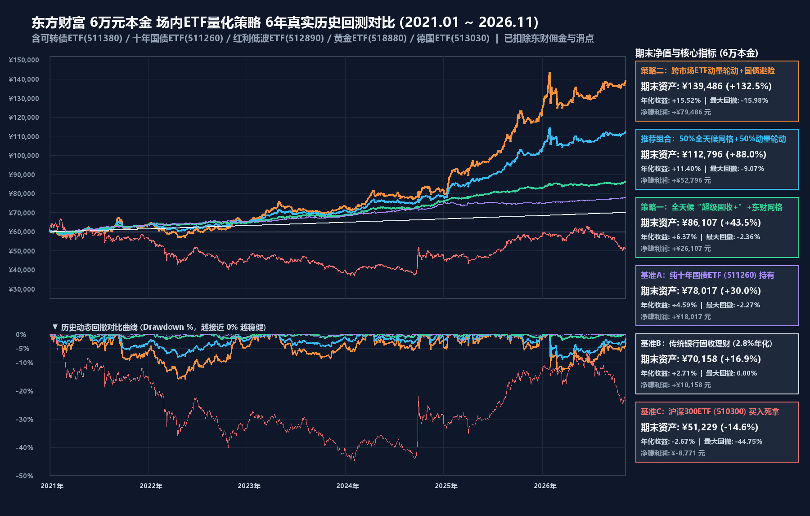

# 东方财富场内 ETF 量化交易与严格实盘回测系统 (EastMoney ETF Quant v2.0)

面向 **5万 ~ 20万元本金**、适配东方财富 **「万1.5 + 不免5（单笔最低5元佣金）+ 100股整手交易」** 真实交割规则的本地 Python 量化实盘信号与零注水历史回测系统。

## 核心策略架构（40/60 二合一低摩擦组合）

1. **40% 策略一：全天候“超级固收+”低波底座 + 双债利率风险保护伞**
   - **标的池**：`511260` 十年国债ETF（长债破位加息期自动切换 `511360` 短融ETF）、`512890` 红利低波ETF、`511380` 可转债ETF、`518880` 黄金ETF、`513030` 德国ETF。
   - **风控机制**：20日波动率倒数动态配权 + `MA20 & MA60` 双均线破位减仓转债保护（债券安全垫保底 `>= 35%`）+ 十年国债跌破 `MA60` 且 20 日跌幅超 `-0.30%` 时自动平移至 `511360 短融ETF` 避险。

2. **60% 策略二：6大零溢价跨资产多维动量轮动 + Top-3 排名迟滞缓冲**
   - **进攻标的池**：`512890` 红利低波ETF（A股高股息价值）、`159915` 创业板ETF（A股高弹性科技成长）、`513030` 德国ETF（欧洲股市DAX）、`511380` 可转债ETF（股债混合）、`518880` 黄金ETF（贵金属避险）、`159980` 有色ETF（国内工业金属商品期货）；避险安全垫为 `511260 / 511360`。
   - **多周期稳健打分**：对数价格 **10日(30%) + 20日(45%) + 30日(25%)** 线性回归年化斜率 × 拟合优度 $R^2$，经波动率风险调整后选取 Top 2。
   - **Top-3 排名缓冲防换手**：已持有的主力 ETF 只要仍居合格池前 3 名且站稳 `MA20`，免于因第 2、3 名微弱轮换产生数万元无效换仓；当所有风险资产趋势转弱时，100% 切入安全债券避险。
   - **停用盘中负收益网格**：严格路径回测证实，在动量组合上开启盘中条件单网格会过早卖飞主升浪并占用 5.5% 闲置资金；停用盘中网格后将现金缓冲降至 `1.5%`（真实资金利用率 `~98.5%`），实测年化净增 `+1.36%`。

3. **实时 IOPV 折溢价双阈值防雷 (`qdii_premium_guard.py`)**
   - 实时拉取 `513030`、`159980`、`159915` 场内现价与官方实时 IOPV 净值：空仓新买溢价熔断线 `2.80%`；已持仓考虑欧股跨时区 IOPV 滞后，持仓容忍线 `5.50%`，杜绝假性溢价折腾。

---

## 6 年严格实盘级回测表现 (`2021-01-04 ~ 2026-11-11`，60,000 元初始本金)

> **100% 零注水实盘口径**：严格按 `raw_close` 撮合 **100股整手**（精准结算份额拆分与现金分红）、逐笔扣除 **万1.5 最低 5 元佣金 + 万2 滑点**、严格按 **ISO 自然周最后一个交易日（周五 14:45）** 单一账户动态配平，**0 盘中网格注水**。

| 策略 / 基准 | 期末总资产 | 累计总收益率 | 复合年化 (CAGR) | 最大回撤 (MaxDD) | 夏普比率 | 6年实缴佣金 |
| :--- | :---: | :---: | :---: | :---: | :---: | :---: |
| **策略二：跨资产多维动量轮动 (整手·不免5)** | `¥142,042` | `+136.74%` | **`15.87%`** | `-11.13%` | `1.00` | `¥3,116 (468笔)` |
| **推荐组合：40%全天候底座 + 60%跨资产动量 (整手·不免5)** | **`¥113,943`** | **`+89.90%`** | **`11.59%`** | **`-7.82%`** | **`1.09`** | **`¥3,338 (649笔)`** |
| **策略一：全天候“超级固收+”底座 (整手·不免5)** | `¥79,228` | `+32.05%` | **`4.87%`** | **`-1.95%`** | `1.10` | `¥1,624 (297笔)` |
| 基准A：纯十年国债ETF (`511260`) 持有 | `¥77,938` | `+29.90%` | `4.57%` | `-2.27%` | `1.17` | - |
| 基准B：传统银行固收理财 (`2.8%` 年化) | `¥70,521` | `+17.54%` | `2.80%` | `0.00%` | - | - |
| 基准C：沪深300ETF (`510300`) 买入死拿 | `¥51,414` | `-14.31%` | `-2.60%` | `-44.75%` | `-0.24` | - |

**推荐组合分年度真实净收益（连续 6 年 100% 正收益）**：
`2021年 +11.90%` ｜ `2022年(熊市) +10.14%` ｜ `2023年 +2.20%` ｜ `2024年 +9.54%` ｜ `2025年 +29.89%` ｜ `2026年 +5.97%`

---

## 目录结构与日常使用

- `一键更新行情并生成今日东财信号.bat`：**每周五 14:45** 双击运行，自动拉取最新行情、检测实时 IOPV 折溢价率、运行严格整手回测、计算【先卖后买】差额指令单，并自动打开可视化看板 `output/dashboard.html`（周中运行会自动提示“非周五调仓日·仅供预览”）。
- `确认已完成今日调仓_同步持仓.bat`：每周五在东方财富 APP 按指令完成买卖后双击运行，自动将最新实际持仓同步至 `my_holdings.json`。
- `fetch_eastmoney_data.py`：东方财富 + 腾讯财经双源历史 K 线（前复权 & 真实不复权）与盘中秒级现价采集模块。
- `qdii_premium_guard.py`：主力跨境与商品 ETF 实时 IOPV 与双阈值折溢价熔断模块。
- `backtest_engine.py`：100股整手 + 万1.5不免5 + 自然周周五调仓严格实盘回测核心引擎。
- `eastmoney_live_signal.py`：与回测引擎 100% 同源的实盘差额指令生成器（含 Top-3 持仓缓冲与 4% 防磨损微调锁）。
- `backtest_min5_fee.py`：不同佣金制度、防微调锁开关及 5万~20万本金规模敏感性对比测试。
- `generate_visuals.py`：生成高分辨率回测图 `output/backtest_comparison.png` 与交互式终端看板 `output/dashboard.html`。
