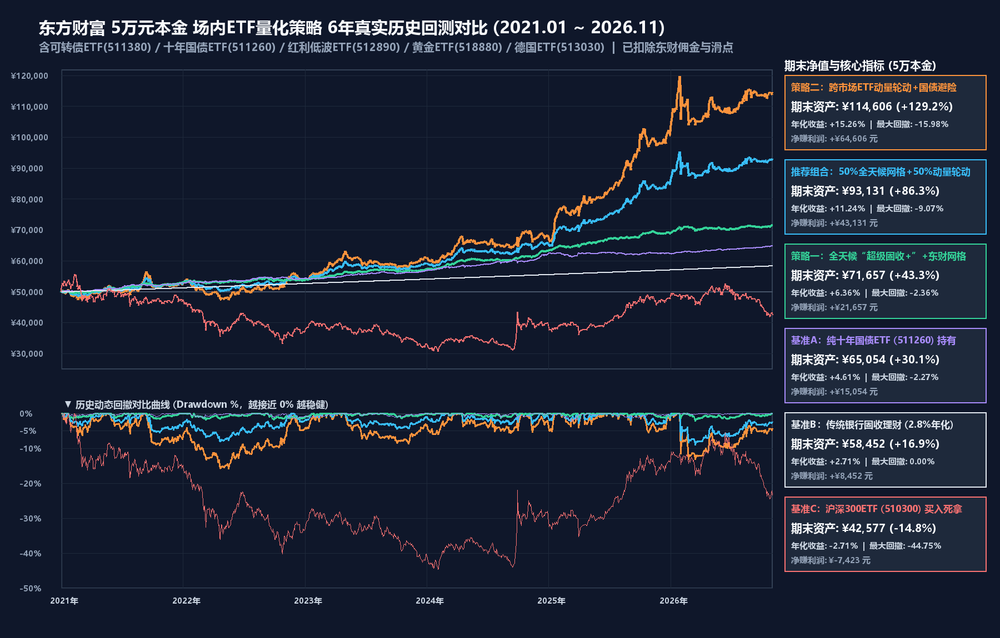

# 东方财富场内 ETF 量化交易与回测系统 (EastMoney ETF Quant)

面向 **5万 ~ 10万元本金**、**零权限门槛**、适配东方财富 **「万1.5 + 不免5（单笔最低5元佣金）」** 规则的本地 Python 量化实盘信号与历史回测系统。

## 核心策略架构（50/50 二合一组合）

1. **50% 策略一：全天候“超级固收+”风险平价 + 不免5定制大步长网格**
   - **标的池**：`511260` 十年国债ETF、`512890` 红利低波ETF、`513030` 德国ETF、`511380` 可转债ETF、`518880` 黄金ETF。
   - **风控机制**：20日波动率倒数动态配权 + `MA20 & MA60` 双均线破位减半转国债保护（国债仓位保底 `>= 35%`）。
   - **不免5大网格增强**：仅对持仓 `>= 16%` 本金的主力品种开启步长 `>= 2.20%`、单格约 `2,800元+` 的东方财富条件单网格，扣除双边 10 元最低佣金后单次闭环净赚 50~60 元。

2. **50% 策略二：跨市场 ETF 动量斜率 × $R^2$ 轮动 + 国债绝对避险**
   - **标的池**：`512890` 红利低波ETF、`513030` 德国ETF、`511380` 可转债ETF、`518880` 黄金ETF、`510500` 中证500ETF，避险池 `511260` 十年国债ETF。
   - **动量打分**：对数价格 20日/10日线性回归年化斜率 × 拟合优度 $R^2$，经波动率风险调整后选取 Top 2。
   - **绝对趋势过滤**：当所有风险资产动量转负或跌破 20 日均线时，100% 切入 `511260 十年国债ETF` 避险。

3. **跨境 ETF 实时 IOPV 溢价率熔断 (`qdii_premium_guard.py`)**
   - 每次生成实盘信号时自动拉取场内实时现价与官方实时 IOPV 净值，若跨境 ETF 实时溢价率 `> 2.50%`，自动触发禁买熔断并将仓位转入 `511260 十年国债ETF`。

---

## 6 年真实历史回测表现 (`2021-01-04 ~ 2026-11-06`，50,000 元初始本金)

| 策略 / 基准 | 期末总资产 | 累计总收益率 | 复合年化 (CAGR) | 最大回撤 (MaxDD) | 夏普比率 |
| :--- | :---: | :---: | :---: | :---: | :---: |
| **策略二：跨市场 ETF 动量轮动 + 国债避险** | `¥114,664` | `+129.33%` | **`15.29%`** | `-15.98%` | `1.07` |
| **推荐二合一（50%全天候 + 50%动量，万1.5+不免5实盘扣费）** | **`¥90,912`** | **`+81.82%`** | **`10.81%`** | **`-7.96%`** | **`1.22`** |
| **策略一：全天候“超级固收+” + 网格** | `¥71,698` | `+43.40%` | **`6.37%`** | **`-2.36%`** | `1.44` |
| 对比基准：传统银行固收理财 (`2.8%` 年化) | `¥58,763` | `+17.53%` | `2.80%` | `0.00%` | - |
| 对比基准：沪深300ETF (`510300`) 买入死拿 | `¥44,507` | `-10.99%` | `-1.98%` | `-41.90%` | `-0.14` |

---

## 目录结构与日常使用

- `一键更新行情并生成今日东财信号.bat`：**每周五 14:45** 双击运行，自动拉取最新行情、检测跨境 ETF 实时溢价率、计算【先卖后买】差额指令单，并自动打开交互式可视化看板 `output/dashboard.html`。
- `确认已完成今日调仓_同步持仓.bat`：在东方财富 APP 按指令完成买卖后双击运行，自动将最新实际持仓同步至 `my_holdings.json`。
- `fetch_eastmoney_data.py`：东方财富 + 腾讯财经双源历史 K 线（前复权 & 不复权）采集模块。
- `qdii_premium_guard.py`：跨境 ETF 实时 IOPV 与折溢价率监控熔断模块。
- `backtest_engine.py`：核心策略历史回测引擎。
- `backtest_min5_fee.py`：专门针对「万1.5 + 不免5（最低5元）」与不同本金规模的回测脚本。
- `eastmoney_live_signal.py`：实盘挂单指令、防磨损微调锁与东方财富网格条件单参数生成器。
- `generate_visuals.py`：生成高分辨率回测图 `output/backtest_comparison.png` 与交互式看板 `output/dashboard.html`。
